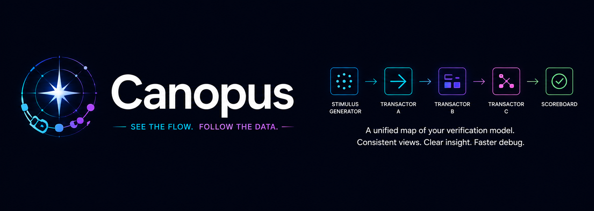

<div align="center">
  
</div>

<br/>

**TLM topology visualiser for UVM-based hardware verification environments.**

Canopus reads a metadata-driven manifest file describing a UVM testbench topology and produces an interactive diagram showing component containment and TLM communication connections. It runs as a desktop application (Electron) and as a CLI tool for static SVG export.

---

## Overview

```
.canopus.yaml manifest
        │
        ▼
   canopus validate      ← schema + semantic validation
        │
        ▼
   manifest-to-elk       ← transform to ELK graph JSON
        │
        ▼
   elk.layout()          ← layered Sugiyama layout
        │
        ▼
   React + SVG           ← interactive renderer (Electron)
   render-static         ← static SVG (CLI)
```

---

## Quick Start

### Installation

```bash
# from the project root
npm install
```

### Run the desktop app

```bash
npm run dev
```

Then use **File → Open Manifest** (⌘O) to load a `.canopus.yaml` file.

### CLI usage

```bash
# Validate a manifest
node cli.js validate my_topology.canopus.yaml

# Render a static SVG
node cli.js render my_topology.canopus.yaml --output my_topology.svg

# Run the ELK layout and emit the JSON
node cli.js layout my_topology.canopus.yaml --output my_topology.layout.json
```

### Try the example topologies

```bash
node cli.js render topologies/t1_canonical_single_agent.canopus.yaml
node cli.js render topologies/t3_hierarchical_sub_envs.canopus.yaml
```

---

## Documentation

| Document | Audience | Description |
|---|---|---|
| [Authoring Guide](docs/authoring-guide.md) | Architects | How to write `.canopus.yaml` manifest files |
| [Reference](docs/reference.md) | All | Component and connection type taxonomy |
| [Schema Changelog](docs/schema-changelog.md) | All | Schema version history and migration notes |
| [Prior-Art Survey](docs/prior-art.md) | All | What already exists, where Canopus differs, and its risks |

---

## Project Structure

```
canopus/
├── electron/
│   ├── main.ts              Electron main process
│   └── preload.ts           IPC bridge (contextBridge)
├── renderer/
│   ├── tokens.js            Visual design tokens
│   ├── useCanopusState.js   Interaction state hook (all 5 features)
│   ├── CanopusEdge.jsx      SVG edge renderer
│   ├── CanopusNode.jsx      SVG node renderer
│   ├── CanopusCanvas.jsx    Layout pipeline + SVG canvas
│   ├── CanopusToolbar.jsx   Interaction controls
│   └── CanopusApp.jsx       Root React component
├── tests/
│   ├── validate.test.js     Validator unit tests (30 tests)
│   └── transform.test.js    Transform unit tests (30 tests)
├── topologies/              Five reference topology fixtures
├── manifest-to-elk.js       Canopus manifest → ELK JSON transform
├── validate.js              AJV-based two-pass validator
├── render-static.js         Programmatic SVG renderer (CLI)
├── cli.js                   Command-line interface
├── types.ts                 TypeScript type definitions
├── manifest.schema.json     JSON Schema for manifest validation
├── renderer.tsx             Renderer process entry point
├── index.html               BrowserWindow HTML template
├── vite.config.ts           Vite build configuration
├── tsconfig.json            Base TypeScript configuration
└── tsconfig.electron.json   Electron main/preload TypeScript config
```

---

## Interaction Features

| Feature | How to use |
|---|---|
| **Hierarchical drill-down** | Click the +/− toggle on any compound node to expand or collapse it |
| **Edge family toggle** | Click TLM / REF / REG buttons in the toolbar to show/hide connection families |
| **Abstraction level filter** | Drag the Level slider to show only components at or above a given depth |
| **Transaction type annotation** | Toggle the Annotations button to show/hide transaction type labels on edges |
| **Path tracing** | Click any component to highlight its upstream and downstream connections |

---

## Running Tests

```bash
npm test

# Single suite
node --experimental-vm-modules node_modules/.bin/jest validate
node --experimental-vm-modules node_modules/.bin/jest transform

# With coverage
node --experimental-vm-modules node_modules/.bin/jest --coverage
```

---

## Schema Version

Current schema version: **0.1**

All manifest files must declare `canopus: "0.1"` at the top level.
See [Schema Changelog](docs/schema-changelog.md) for version history.

---

## License

Released under the MIT License. See [LICENSE.md](LICENSE.md).
